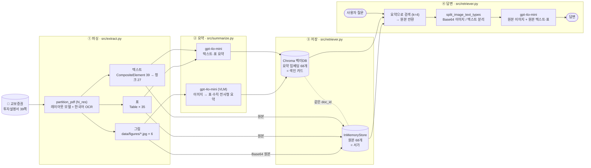

# 멀티모달 RAG — 교보증권 투자설명서의 표·그래프까지 읽는 질의응답

> 증권 투자설명서 PDF의 **텍스트 · 표 · 이미지(그래프·표 그림)** 를 모두 검색 대상으로 삼아, 일반 텍스트 RAG가 **"자료에 없다"고 답하거나 틀리는 숫자**를 원본 이미지를 근거로 정확히 답하는 멀티모달 RAG

---

## 1. 문제 정의

### 자료
- **교보증권 제12879회 주가연계파생결합사채 투자설명서(일괄신고)** (2026.11.04, 39쪽, 모집가액 13,329,540,000원)
- 금융감독원 전자공시시스템(DART, dart.fss.or.kr)에 공개된 문서입니다. 저장소에는 PDF를 포함하지 않으므로(`.gitignore`) 직접 내려받아 `data/[교보증권]투자설명서(일괄신고)(2026.11.04).pdf`로 저장하세요.
- 구성: 본문 텍스트 + 표 35개 + 그림 6개

| 그림 | 쪽 | 내용 |
|---|---|---|
| `figure-13-2` | 13 | 상환 시점별 세전 수익률 구조 (6개월 3.05% … 만기 18.30%) |
| `figure-13-3` | 13 | 과거 데이터 백테스팅 그래프 (수익률 vs KOSPI200) |
| `figure-14-4` | 14 | **수익률 모의실험 결과표** (수익률별·상환 차수별 횟수와 빈도율) |
| `figure-18-5` | 18 | 중도상환 절차도 (신청일 → +1영업일 → +2영업일) |
| `figure-34-6` | 34 | KOSPI200 지수 추이 |
| `figure-6-1` | 6 | 예금보험공사 "비보호" 표시 |

### 이 자료에서 일반 RAG가 실패하는 이유
1. **핵심 숫자가 그림 안에만 있습니다.** 모의실험 결과(1차 조기상환 97.21%, 5,009회 등)는 PDF에 **표 모양의 이미지**로 들어 있습니다. PDF 텍스트 레이어 39쪽 전체에서 `97.21`, `5009`를 검색하면 **0건**입니다. 본문에는 "(3) 기초자산의 과거 데이터를 이용한 수익률 모의실험"이라는 제목만 있습니다.
2. **상환 시점과 수익률의 대응이 그래프로만 표현됩니다.** "18개월 후 조기상환 시 9.15%"라는 대응은 수익구조 그래프에만 있고, 본문에는 `18개월`이라는 말이 나오지 않습니다.
3. 그래서 텍스트만 검색하는 RAG는 **"자료에 없습니다"라고 답하거나, 본문에 있는 다른 숫자(만기 수익률 18.30% 등)를 가져와 자신 있게 틀립니다**(5장).

👉 **목표:** 그림 속 표·그래프를 근거로 상품의 **수익 구조와 모의실험 결과**를 정확히 답하는 RAG를 만들고, 텍스트 전용 RAG와 비교해 개선 효과를 **증거로** 보입니다.

---

## 2. 아키텍처



### 핵심 구조: "검색은 요약으로, 답변은 원본으로"

- **왜 이미지를 요약하는가?** 임베딩 검색은 텍스트끼리 비교하기 때문에 이미지는 그 자체로 검색되지 않습니다. VLM이 이미지를 "상환 1차: 5009회, 97.21%…"처럼 **질문과 매칭될 수 있는 글**로 바꿔 줘야 검색 대상이 됩니다.
- **왜 요약만 LLM에 주지 않는가?** 요약은 정보가 손실된 사본입니다. 실제로 이 프로젝트에서도 VLM이 KOSPI200 그래프의 수치를 지어낸 사례가 있었습니다(6장). 그래서 요약은 **'어느 원본을 꺼낼지' 고르는 데만** 쓰고, 답변 모델에는 **원본 이미지와 원본 표·텍스트**를 직접 보여 줍니다.
- **두 저장소를 잇는 고리는 `doc_id`입니다.** 요약(벡터DB)과 원본(docstore)을 같은 UUID로 저장하기 때문에, 요약으로 찾으면 원본이 따라 나옵니다. 도서관에 비유하면 색인 카드로 찾고, 서가에서 진짜 책을 꺼내 주는 것과 같습니다.

---

## 3. 실행 방법

### 사전 준비 (OS 프로그램, pip로 설치되지 않음)
| 도구 | 역할 | Windows | macOS |
|---|---|---|---|
| Poppler | PDF → 이미지 렌더링 | `winget install oschwartz10612.Poppler` | `brew install poppler` |
| Tesseract | OCR | `winget install UB-Mannheim.TesseractOCR` | `brew install tesseract tesseract-lang` |

- 한국어 OCR 언어팩: 프로젝트 루트에 `.tessdata/` 폴더를 만들고 `eng.traineddata`, `osd.traineddata`(Tesseract 설치 폴더의 `tessdata`)와 [kor.traineddata](https://github.com/tesseract-ocr/tessdata_fast/raw/main/kor.traineddata)를 넣으세요. `src/extract.py`의 `ensure_os_tools()`가 `TESSDATA_PREFIX`를 자동으로 설정합니다(관리자 권한 불필요).
- 설치 직후 에디터를 재시작하지 않아도 `ensure_os_tools()`가 기본 설치 경로를 PATH에 보정합니다.

### 설치
```bash
git clone <저장소 주소>
cd multimodal-rag

python -m venv .venv                 # Python 3.11 권장
source .venv/bin/activate            # Windows: .venv\Scripts\activate

pip install --upgrade pip
pip install -r requirements.txt      # 동일 버전 재현: pip install -r requirements.lock.txt

python -m ipykernel install --user --name multimodal-rag --display-name "Python (multimodal-rag)"

cp .env.example .env                 # Windows: copy .env.example .env
# .env를 열어 OPENAI_API_KEY 입력
```

- `requirements.txt`: 직접 관리하는 의존성 목록
- `requirements.lock.txt`: `pip freeze`로 고정한 전체 버전 목록 (실행을 확인한 환경 재현용)

### 실행
1. PDF를 `data/[교보증권]투자설명서(일괄신고)(2026.11.04).pdf`로 저장합니다.
2. VS Code에서 `notebooks/Multi_modal_RAG.ipynb`를 열고 커널로 `Python (multimodal-rag)`를 선택한 뒤 **Run All**을 누릅니다.
3. 첫 실행은 약 6~7분 걸립니다(PDF 파싱 약 5분).
   - 파싱 결과는 `data/processed/kyobo/extracted.pkl`에 저장됩니다.
   - 요약 결과는 `data/cache/`에 캐시됩니다.
   - 그래서 **다시 실행할 때는 파싱을 건너뛰고 요약 API 비용도 들지 않습니다.**
4. (선택) [Ollama](https://ollama.com)에서 `ollama pull llama3.1:8b`를 받아 두면 마지막 번역 체인 셀이 실행됩니다. 없으면 그 셀은 건너뜁니다.

### 폴더 구조
```
multimodal-rag/
├── .env.example                # 필요한 환경변수 템플릿 (실제 키는 .env, Git 제외)
├── .gitignore
├── requirements.txt            # 의존성 목록
├── requirements.lock.txt       # 버전 고정 파일
├── README.md
├── data/                       # PDF, figures/, processed/, cache/ 는 Git 제외
├── notebooks/
│   └── Multi_modal_RAG.ipynb   # 전체 파이프라인 실행 노트북 (실행 결과 포함)
├── practice/                   # 수업 단계별 실습 노트북 (추출 → 요약 → 임베딩·체인)
└── src/
    ├── extract.py              # ① PDF 파싱·분류·재분할, OS 도구 경로 보정
    ├── summarize.py            # ② 텍스트·표·이미지 요약 체인 (+ 결과 캐시)
    └── retriever.py            # ③ 다중 벡터 검색기 / ④ 멀티모달 RAG 체인
```

---

## 4. 기술 선택 근거

| 항목 | 선택 | 이유 |
|---|---|---|
| 파싱 전략 | `strategy="hi_res"` + `languages=["kor","eng"]` | 레이아웃 모델이 페이지에서 그림 영역을 찾아 `data/figures/`로 잘라 줍니다. 한국어 OCR이 없으면 표·그림 속 한글이 깨집니다. |
| 표 | `infer_table_structure=True` | 상환 조건, 중도상환 조건 같은 정보가 대부분 표에 있습니다. 표 35개를 `Table`로 추출해 따로 요약했습니다. |
| 청킹 | `by_title`(4,000자) → tiktoken 2,000토큰 / overlap 200 | 제목 단위로 먼저 묶고(`CompositeElement` 39개), LLM이 쓰는 **토큰** 기준으로 다시 잘라 크기를 고르게 맞췄습니다(27개). overlap 200은 경계에서 문장이 잘리는 것을 막습니다. |
| 모델 | 요약·이미지 요약·답변 모두 `gpt-4o-mini` | 수업 기준 모델이고 비용이 낮습니다. 이미지도 읽을 수 있는 멀티모달 모델이라 VLM 역할까지 맡깁니다. |
| **이미지 요약 프롬프트** (직접 수정) | "간결한 요약" → **"표는 모든 행, 그래프는 모든 수치를 옮겨 적기"** | 이 변경이 결과를 갈랐습니다(5-3). 첫 실행에서는 모의실험 결과표의 '1차~5차 조기상환' 표가 요약에서 빠져, 해당 질문에 이미지가 검색되지 않았습니다. |
| 이미지 해상도 | `detail: "high"` | 표 그림 속 작은 숫자(5009, 97.21%)를 읽기 위해 고해상도로 보냅니다. |
| 노이즈 이미지 | 8KB 미만 제외 | 아이콘·기호 조각을 검색 대상에서 빼기 위한 필터입니다(이 문서는 6장 모두 8KB 이상). |
| 임베딩 | `text-embedding-3-small` | 한국어 검색 품질이 충분하고 저렴합니다. 문서 68개 규모라 대형 모델은 필요 없습니다. |
| 출력 언어 | 요약·답변 모두 **한국어** | 질문이 한국어라 요약도 한국어여야 같은 언어끼리 임베딩 유사도가 높게 나옵니다. 이미지 요약은 지시문을 영어로 쓰고(지시 이행력) 출력만 한국어로 받습니다. |
| 비교 실험 | 텍스트 RAG도 **같은 모델·같은 지시문** | `build_rag_chain(retriever)`에 넣는 검색기만 바꿔서, 차이가 **검색 대상**에서만 나도록 했습니다. |
| 비용 | 요약 캐시 (`data/cache/*.json`, 내용 해시 키) | 같은 입력은 API를 다시 호출하지 않습니다. 모델·프롬프트·이미지가 바뀌면 키가 달라져 자동으로 다시 요약합니다. |

---

## 5. 결과

### 5-1. 추출 결과
| 항목 | 개수 |
|---|---|
| 텍스트 블록 (`CompositeElement`) → 토큰 분할 청크 | 39 → 27 |
| 표 (`Table`) | 35 |
| 추출 이미지 (`data/figures/`) | 6 |
| 벡터DB 요약 / docstore 원본 | 68 / 68 |

### 5-2. Before / After — 텍스트 전용 RAG vs 멀티모달 RAG
조건: 같은 질문, 같은 답변 모델(gpt-4o-mini), 같은 지시문을 쓰고 **검색 대상만** 다르게 했습니다(텍스트 원문 청크만 vs 텍스트+표+이미지 요약).

| # | 질문 | 정답 (원본) | 텍스트 전용 RAG | 멀티모달 RAG |
|---|---|---|---|---|
| 1 | 모의실험 결과 1차 조기상환 빈도율과 횟수는? | 97.21%, 5,009회 (14쪽 표 그림) | ❌ "자료에 포함되어 있지 않습니다" | ✅ 97.21%, 5009회 |
| 2 | 모의실험에서 2차, 3차 조기상환은 각각 몇 회, 몇 %? | 80회 1.55% / 64회 1.24% | ❌ 6회 30% / 0회 0% | ✅ 80회 1.55% / 64회 1.24% |
| 3 | 모의실험 결과 원금만 지급(0%)된 경우는 몇 번? | 0회 | ❌ 6번 | ❌ 3번 (6장 참고) |
| 4 | 18개월 후 조기상환 시 세전 수익률은? | 9.15% (13쪽 그래프) | ❌ 18.30% (만기 수익률을 가져옴) | ✅ 9.15% |
| 5 | 만기평가가격이 최초기준가격의 80% 이상이면 만기에 얼마를 받나? | 액면금액의 118.30% | ❌ "최초기준가격으로 지급" | ✅ 액면금액의 118.30% |
| 6 | 중도상환금은 언제 지급되나? | 신청일(불포함) 이후 2영업일 | ⚠️ "평가일 후 2영업일" (기준일이 틀림) | ✅ 신청일(불포함) 이후 2영업일 |

**정답 수: 텍스트 전용 RAG 0개(부분 정답 1) → 멀티모달 RAG 5개**

멀티모달 RAG에서 질문별로 검색된 원본 종류(상위 4개)는 다음과 같습니다. 1·2·4번에서는 **이미지 원본이 검색되어** 정답을 냈습니다.

| # | 검색된 원본 종류 |
|---|---|
| 1 | 텍스트, 표, **이미지**, 표 |
| 2 | 표, 표, 표, **이미지** |
| 3 | 표, 텍스트, 표, 텍스트 ← 이미지가 검색되지 않음 |
| 4 | **이미지**, 텍스트, 표, 표 |
| 5 | 표, 표, 표, 이미지 |
| 6 | 표, **이미지**, 표, 표 |

**해석**
- 1·2·4번은 정답이 **그림에만** 있어서 텍스트 RAG는 찾을 수 없었습니다. 이때 텍스트 RAG는 "모른다"(1번)고 하거나, 본문의 다른 숫자를 가져와 **자신 있게 틀렸습니다**(2번 6회·30%, 4번 18.30%).
- 5·6번처럼 답이 본문 표에 있어도, 텍스트 RAG는 표 요약 없이 원문 청크만 검색하기 때문에 근처 문장을 잘못 조합했습니다. 멀티모달 RAG는 **표 요약**으로 정확한 표를 찾아 정답을 냈습니다.
- 전체 답변 원문은 노트북 5번 셀 출력에 있습니다.

### 5-3. 개선 과정 (시행착오)

| 시도 | 결과 | 판단 |
|---|---|---|
| **① 첫 실행**: "간결한 요약" 프롬프트 + 잘린 그림의 제목·범례를 보완하려고 **페이지 전체 이미지를 맥락으로 함께 제공** | 모의실험 표 그림의 요약이 "수익률 분포 표"로 뭉뚱그려지고, **'상환 1차~5차' 표가 요약에서 빠짐**. 그래서 "1차 조기상환" 질문에 이미지가 검색되지 않아 멀티모달 RAG도 **"자료에 없습니다"**. 수익구조 그래프 요약에는 수치가 하나도 없었음. **정답 2/6** | 요약이 질문과 매칭될 단어를 담지 못하면 검색 자체가 안 된다 |
| **② 원인 분리 실험**: 그림 2장에 전사형 프롬프트를 쓰고 **페이지 맥락 유무만** 바꿔 비교 | 페이지 맥락이 있으면 gpt-4o-mini가 잘린 그림이 아니라 **페이지 본문(최소·최대이익액 표)을 요약**해 버림. 없으면 두 표를 행 단위로 모두 옮겨 적음 | 작은 모델에 이미지 두 장을 주면 주의가 분산된다 → 페이지 맥락 **제거** |
| **③ 최종**: 전사형 프롬프트("표는 모든 행, 그래프는 모든 수치") + 잘린 그림만 | `1차: 5009, 97.21%` …, 수익구조 그래프도 `18개월 후: 9.15%`. **정답 5/6** | ✅ 채택 |

교훈: 멀티모달 RAG의 성능은 **"이미지를 어떤 글로 바꾸느냐"** 에서 결정됩니다. 검색은 요약끼리의 경쟁이라, 이미지 요약에 질문의 단어(차수, 개월 수, 수치)가 없으면 원본 이미지가 아무리 정확해도 답변 단계까지 가지 못합니다.

---

## 6. 한계와 개선 방향

- **다른 요약이 이미지를 밀어냅니다 (3번 실패).** 이미지 요약에는 "0% (원금지급): 0, 0.00%"가 들어 있었지만, '원금 지급' 조건을 설명하는 표·본문 요약(표 2개, 텍스트 2개)이 상위 4개를 모두 차지해 이미지가 검색되지 않았습니다. 그 결과 멀티모달 RAG도 엉뚱한 횟수를 답했습니다. 개선 방향은 다음과 같습니다.
  - 타입별 쿼터(이미지 최소 1개)를 두거나 `k`를 늘리기
  - 키워드 검색(BM25)과 섞는 하이브리드 검색
  - 리랭커 사용
- **VLM이 데이터 라벨 없는 그래프의 수치를 지어냅니다.** KOSPI200 지수 추이 그래프(34쪽)는 선만 있고 숫자 라벨이 없습니다. VLM 요약에는 "2020년 약 800, 2022년 약 1000"처럼 실제 그래프와 다른 매끄러운 수치가 적혔습니다. 답변 단계에서는 원본 이미지를 다시 보지만, 검색용 요약이 틀리면 엉뚱한 질문에 이 그래프가 검색될 수 있습니다. 이런 그래프는 요약에 "수치는 눈금 기준 근사치"라고 명시하게 하는 등의 장치가 필요합니다.
- **의미 없는 표도 검색 대상이 됩니다.** 표 35개에는 목차(`투 자 설 명 서 ......… 1`)처럼 정보가 없는 표와 OCR 띄어쓰기가 깨진 표가 섞여 있습니다. 표 길이나 숫자 비율로 걸러내면 검색 노이즈를 줄일 수 있습니다.
- **로컬 번역 모델의 용어 손실:** 영어 답변을 Ollama(`llama3.1:8b`)로 번역하면 "count"가 "카운트"로 남는 등 금융 용어가 어색해집니다. 이전 실행에서는 "조기상환"을 "이행"으로 옮기기도 했습니다. 한국어 문서·한국어 질문이라면 처음부터 한국어로 답하는 기본 체인이 더 정확합니다.
- **인메모리 저장소:** `InMemoryStore`와 임시 Chroma 컬렉션이라 커널을 재시작하면 인덱스를 다시 만들어야 합니다(요약은 캐시되어 비용은 들지 않음). 서비스로 만들려면 영속 저장소(`chroma_db/`, `LocalFileStore` 등)가 필요합니다.
- **평가 규모:** 질문 6건을 원본과 대조해 수동으로 채점했습니다. 정답셋을 늘려 자동 평가(정확 일치율 등)로 확장할 수 있습니다.

---

## 7. 보안
- API 키는 `.env`에만 두고 `.gitignore`로 제외했습니다. 저장소에는 키가 없는 템플릿 `.env.example`만 올립니다.
- 노트북은 키 값을 출력하지 않고, 형식(`sk-`로 시작)만 검사합니다.
- PDF·추출 이미지·중간 결과·캐시·OCR 언어팩은 용량과 재생성 가능성을 고려해 Git에서 제외했습니다.
