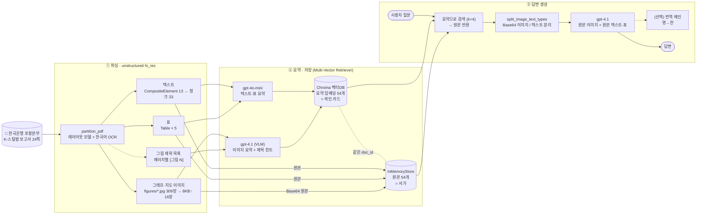
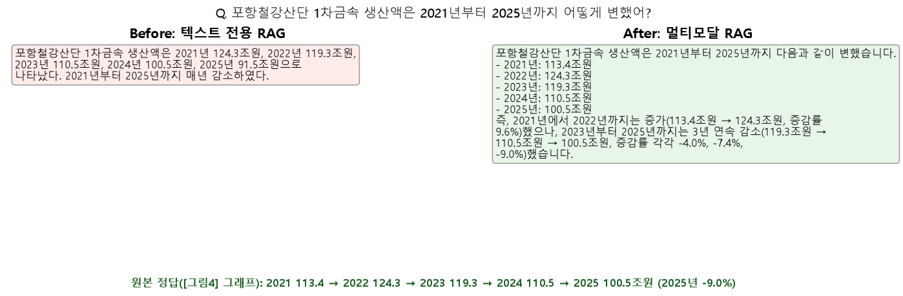
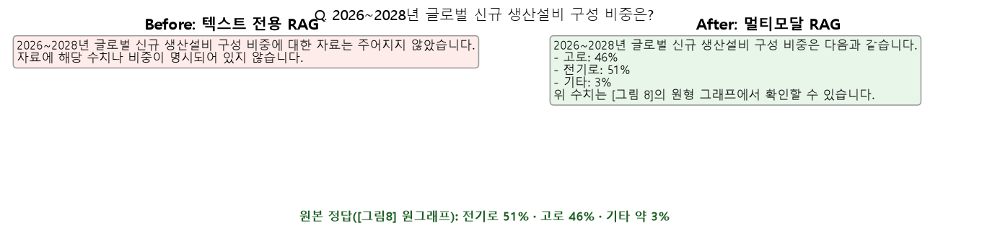

# 멀티모달 RAG — 「K-스틸법과 포항지역 철강산업의 전환과제」 그래프·표까지 읽는 질의응답

> 한국은행 지역경제 보고서 PDF의 **텍스트 · 표 · 그래프 이미지**를 모두 검색 대상으로 삼아, 일반 텍스트 RAG가 **찾지 못하거나 잘못 읽는 그래프 수치**를 정확하게 답하는 멀티모달 RAG

---

## 1. 문제 정의

### 자료
- **한국은행 포항본부 「K-스틸법과 포항지역 철강산업의 전환과제」** (지역경제조사연구 포항 2026-3, 2026.9, 24쪽)
- 공개 자료이며 한국은행 홈페이지(조사·연구 → 지역경제보고서)에서 받을 수 있습니다. 저장소에는 PDF를 포함하지 않으므로(`.gitignore`) 직접 내려받아 `data/k_steel_pohang_2026.pdf`로 저장하세요.
- 구성: 본문 텍스트 + **그래프·지도·도식 18개**([그림1]~[그림18]) + **표 3개**([표1] 주요국 수입규제, [표2] 주요국 지원정책, [표3] 포스코 8대 전략제품) + 참고 박스 속 표(K-스틸법 개요, 수소환원제철 추진 일정)

### 이 자료에서 일반 RAG가 실패하는 이유
1. **수치가 그래프에만 있습니다.** 본문은 "생산활동은 감소세", "향후 증설이 전기로 중심" 같은 결론만 말하고, 연도별 값(포항철강산단 1차금속 생산액 등)은 그래프에만 있습니다.
2. **텍스트 레이어의 그래프 숫자에는 연도가 붙어 있지 않습니다.** [그림4]를 텍스트로 추출하면 `113.4 124.3 119.3 110.5 100.5 29.2 9.6 -4.0 -7.4 -9.0 ... 2021 2022 2023 2024 2025`처럼 **값·증감률·연도가 따로 나열**됩니다. 텍스트만 보는 모델은 연도를 한 칸씩 밀어 매칭하거나 없는 값을 지어냅니다(환각, 5-4 참고).
3. **원그래프·일정표·색 범례는 문장으로 남지 않습니다.** [그림8] 원그래프의 비중, [그림18]의 국가별 수입 구성(색으로만 구분), 수소환원제철 추진 일정표는 본문에 서술되지 않거나 일부만 서술됩니다.
4. **잘린 그래프 이미지에는 제목이 없습니다.** HWP로 만든 PDF라 그림 제목이 이미지 바깥 텍스트로 들어가 있어서, 이미지만 보면 무엇에 대한 그래프인지 알 수 없는 경우가 있습니다(4장 '그림 제목 힌트' 참고).

👉 **목표:** 그래프 원본 이미지와 표 구조를 근거로 지역 철강산업의 **연도별 수치와 일정**을 정확히 답하는 RAG를 만들고, 텍스트 전용 RAG와 비교해 개선 효과를 **증거로** 보이는 것입니다.

---

## 2. 아키텍처



### 핵심 구조: "검색은 요약으로, 답변은 원본으로"

- **왜 이미지를 요약하는가?** 임베딩 검색은 텍스트끼리 비교하는 방식이라 그래프 이미지는 그 자체로는 검색되지 않습니다. VLM이 그래프를 "[그림4] 포항철강산단 1차금속 생산액… 검색 키워드: 생산액, 증감률"처럼 **검색되기 좋은 문장**으로 바꿔 줘야 질문과 매칭됩니다.
- **왜 요약만 LLM에 주지 않는가?** 요약은 정보 손실이 있는 사본이기 때문입니다. 이 프로젝트에서도 VLM 요약이 [그림12]의 국가명을 잘못 읽었습니다(5-2). 요약을 그대로 답변 근거로 쓰면 오류가 그대로 답에 들어갑니다. 그래서 **요약은 '어느 원본을 꺼낼지' 고르는 데만** 쓰고, 답변 모델에는 **원본 그래프 이미지와 원본 표**를 직접 보여 줍니다.
- **두 저장소를 잇는 고리는 `doc_id`입니다.** 요약(벡터DB)과 원본(docstore)을 같은 UUID로 저장하기 때문에, 요약으로 찾으면 원본이 따라 나옵니다. 도서관에 비유하면 색인 카드로 찾고 서가에서 진짜 책을 꺼내 주는 것과 같습니다.

---

## 3. 실행 방법

### 사전 준비 (OS 프로그램, pip로 설치되지 않음)
| 도구 | 역할 | Windows | macOS |
|---|---|---|---|
| Poppler | PDF → 이미지 렌더링 | `winget install oschwartz10612.Poppler` | `brew install poppler` |
| Tesseract | OCR | `winget install UB-Mannheim.TesseractOCR` | `brew install tesseract tesseract-lang` |

- 한국어 OCR 언어팩: `mkdir .tessdata` 후 `eng/osd.traineddata`(Tesseract 설치 폴더의 `tessdata`)와 [kor.traineddata](https://github.com/tesseract-ocr/tessdata_fast/raw/main/kor.traineddata)를 넣으세요. `src/config.py`가 `TESSDATA_PREFIX`를 자동으로 설정합니다(관리자 권한 불필요).
- 설치 후에는 터미널과 에디터를 완전히 재시작하세요. 재시작 전이라도 `src/config.py`의 `ensure_os_tools()`가 기본 설치 경로를 PATH에 보정합니다.

### 설치
```bash
git clone <저장소 주소>
cd multimodal-rag

python -m venv .venv                 # Python 3.11 / 3.12 권장
source .venv/bin/activate            # Windows: .venv\Scripts\activate

pip install --upgrade pip
pip install -r requirements.txt      # 동일 버전 재현: pip install -r requirements.lock.txt

python -m ipykernel install --user --name multimodal-rag --display-name "Python (multimodal-rag)"

cp .env.example .env                 # Windows: copy .env.example .env
# .env를 열어 OPENAI_API_KEY 입력
```

- `requirements.txt`: 사람이 관리하는 직접 의존성 목록입니다.
- `requirements.lock.txt`: `pip freeze`로 고정한 전체 버전 목록으로, 실행을 확인한 환경을 그대로 재현할 때 씁니다.

### 실행
1. PDF를 `data/k_steel_pohang_2026.pdf`로 저장합니다.
2. VS Code에서 `notebooks/Multi_modal_RAG.ipynb`를 열고 커널로 `Python (multimodal-rag)`를 선택한 뒤 **Run All**을 누릅니다.
3. 전체 실행에는 약 6~8분이 걸립니다(파싱 약 160초). 요약 결과는 `data/cache/`에 캐시되어 **다시 실행할 때 요약 API 비용이 들지 않습니다.**

### 폴더 구조
```
multimodal-rag/
├── .env.example            # 필요한 환경변수 템플릿 (실제 키는 .env, Git 제외)
├── .gitignore
├── requirements.txt / requirements.lock.txt
├── data/                   # PDF, figures/, cache/ 는 Git 제외
├── docs/                   # Before/After 캡처, 질의응답 결과 JSON
├── notebooks/
│   └── Multi_modal_RAG.ipynb   # 전체 파이프라인 실행 노트북 (출력 포함)
└── src/
    ├── config.py           # 경로, 모델, API 키, OS 도구 Path 보정
    ├── extract.py          # ① PDF 파싱·분류·분할, 페이지별 그림 제목 추출
    ├── summarize.py        # ② 텍스트·표·이미지 요약 (+캐시)
    ├── retriever.py        # ② 다중 벡터 검색기 / 비교용 텍스트 검색기
    └── chain.py            # ③ 멀티모달 답변 체인, 텍스트 RAG 체인, 번역 체인
```

---

## 4. 기술 선택 근거

| 항목 | 선택 | 이유 |
|---|---|---|
| 파싱 전략 | `strategy="hi_res"` + `languages=["kor","eng"]` | 이 PDF의 그래프는 래스터 사진이 아니라 HWP가 만든 **벡터 그래픽**입니다. `hi_res` 레이아웃 모델이 그래프 영역을 찾아 이미지로 잘라 줘야 `figures/`가 생깁니다. 한국어 OCR이 없으면 그래프 속 한글 라벨이 깨집니다. |
| 표 | `infer_table_structure=True` | 수소환원제철 추진 일정, 주요국 수입규제 등 **표 5개**를 `Table`로 추출했습니다. 일정표 덕분에 "실증플랜트 완공 시점·규모"(Q4)에 답할 수 있었고, 텍스트 RAG는 이 질문에 답하지 못했습니다. |
| **그림 제목 힌트** (직접 추가) | 같은 페이지의 `[그림 N] 제목` 목록을 VLM 프롬프트에 함께 전달 | 잘린 그래프 이미지에는 제목이 없어서, 처음에는 VLM이 [그림8] 신규 생산설비 원그래프를 **"난방 방식별 비율"**로 잘못 요약했습니다. 파일명 `figure-{페이지}-{순번}.jpg`로 페이지를 알아내고, 그 페이지의 그림 제목 목록을 힌트로 주자 **"[그림8] 2026~2028년 글로벌 신규 생산설비 구성"**으로 정확히 요약했고, Q3가 이 그래프를 검색해 정답을 냈습니다. |
| 청킹 | `by_title`(4,000자) → tiktoken 2,000토큰 / overlap 200 | 섹션(제목) 단위로 먼저 묶고 토큰 기준으로 다시 자릅니다. 한국어는 글자당 토큰 수가 많아 13개 블록이 33개 청크로 나뉘었고, 한 청크가 대략 한 소절이 되어 검색 단위로 적당합니다. overlap 200은 경계에서 문장이 잘리는 것을 막습니다. |
| 텍스트·표 요약 모델 | `gpt-4o-mini` | 텍스트 요약은 난도가 낮아 저렴한 모델로 충분합니다. 요약에는 "핵심 수치·연도·항목명 포함"을 지시했습니다. |
| 이미지 요약 모델 (VLM) | `gpt-4.1` + `detail: high` | 교안의 `gpt-4o-mini`는 그래프 범례 색을 매칭할 때 오류가 잦았습니다. 이미지가 16장뿐이라 상위 모델로 바꿔도 비용 증가는 미미합니다. 작은 숫자를 읽기 위해 고해상도로 입력합니다. (이 API 키 프로젝트에서는 `gpt-4o`를 쓸 수 없어 `gpt-4.1`을 선택했습니다.) |
| 답변 모델 | `gpt-4.1` | 원본 그래프를 직접 읽어야 하므로 비전 성능을 우선했습니다. 비교 실험의 공정성을 위해 **텍스트 RAG도 같은 모델·같은 지시문**을 씁니다. |
| 답변 지시문 | "자료에 명시되지 않은 수식어(전망치 등)를 덧붙이지 말 것" 추가 | 첫 실행에서 숫자는 맞았지만 "2024~2025년 **전망치**"처럼 원문에 없는 수식어가 붙었습니다. 보고서가 2026.9 발간이라 2025년 값도 실적입니다. 지시문을 추가한 뒤 사라졌습니다. |
| 임베딩 | `text-embedding-3-small` | 한국어 검색 품질이 충분하고 저렴합니다. 문서 54개 규모라 대형 모델은 불필요합니다. |
| 프롬프트 언어 | 텍스트 요약·이미지 요약·답변 모두 **한국어 출력** | 질문이 한국어이므로 요약도 한국어여야 **질문과 같은 언어 공간**에서 임베딩 유사도가 높게 나옵니다. 이미지 요약은 지시문은 영어로 쓰고(지시 이행력) 출력만 한국어로 받습니다. |
| 노이즈 이미지 | 8KB 미만 제외 | 309장 중 293장이 표 안의 아이콘·기호 조각(1KB 내외)이었습니다. 크기 필터로 그래프·지도·도식 16장만 남겼습니다. |
| 비용 | 요약 캐시(`data/cache/*.json`, 내용 해시 키) | 노트북을 다시 실행해도 같은 입력은 API를 다시 호출하지 않습니다. 모델·프롬프트·제목 힌트가 바뀌면 키가 달라져 자동으로 다시 요약합니다. |
| 번역 체인 | Ollama(`llama3.1:8b`)가 있으면 사용, 없으면 `gpt-4o-mini` | 오픈소스 모델로 번역 비용을 줄이는 구조입니다. 이 환경에는 Ollama가 없어 `gpt-4o-mini`로 대체했습니다. 결과는 6장을 보세요. |

---

## 5. 결과

### 5-1. 추출 결과
| 항목 | 개수 |
|---|---|
| 텍스트 블록 (`CompositeElement`) → 토큰 분할 청크 | 13 → 33 |
| 표 (`Table`) | 5 |
| 추출 이미지 (`figures/`) | 309장 → 크기 필터 후 **16장** 요약 (그래프 11 · 지도 3 · 도식 1 · 로고 1) |
| 벡터DB 요약 / docstore 원본 | 54 / 54 |

### 5-2. 이미지 요약 육안 검증 (체크포인트 3)
| 그래프 | VLM 요약 | 원본 확인 |
|---|---|---|
| [그림4] 1차금속 생산액 | 2021 113.4조원(29.2%) … 2025 100.5조원(-9.0%) | ✅ 일치 |
| [그림8] 신규 생산설비 구성 | 제목 힌트 전: "**난방 방식별** 비율" ❌ → 힌트 후: "[그림8] 2026~2028년 글로벌 신규 생산설비 구성, 전기로 51%·고로 46%" | ✅ (힌트 후) |
| [그림18] 철스크랩 수입량 | 439 → 478 → 468 → 379 → 216 → 178만톤, 일본 비중 최대 | ✅ 일치 |
| [그림6] 중국 철강 수출 | 0.7 → 0.7 → 0.9 → 1.1 → 1.2억톤, +77.9% | ✅ 일치 |
| [그림12] 주요국 철스크랩 수출량 | 미국 22.9, **독일** 21.4, **영국** 19.0 … | ❌ 실제는 **EU 22.9, 미국 21.4, 튀르키예 19.0** (국가명이 세로쓰기라 오독) |

### 5-3. 질의응답 5건 (멀티모달 RAG)
| # | 질문 | 답변 (요약) | 검색된 원본 종류 (상위 4) | 정답 |
|---|---|---|---|---|
| 1 | 국내 철스크랩 수입량 2020~2025년 변화와 주요 수입국은? | 439 → 478 → 468 → 379 → 216 → 178만톤, 2021년 정점 후 감소. 일본이 대부분, 그 외 미국·러시아 | **이미지**, 텍스트, 텍스트, **이미지** | ✅ |
| 2 | 포항철강산단 1차금속 생산액 2021~2025년 변화는? | 113.4 → 124.3 → 119.3 → 110.5 → 100.5조원, 2023년부터 3년 연속 감소(-4.0, -7.4, -9.0%) | **이미지**, 텍스트, 텍스트, 텍스트 | ✅ |
| 3 | 2026~2028년 글로벌 신규 생산설비 구성 비중은? | 전기로 51%, 고로 46%, 기타 3% | **이미지**, 텍스트, 이미지, 텍스트 | ✅ |
| 4 | 포항 수소환원제철 실증플랜트의 완공 시점과 규모는? | 2028년 완공·가동, 연산 30만 톤 | **표**, 텍스트, 텍스트, 텍스트 | ✅ |
| 5 | 글로벌 철강 생산용 금속 원료 구성 전망(2024/2030/2040)은? | 고로용 철광석 64→58→47%, DRI용 7→9→13%, 철스크랩 29→33→40% | 텍스트, **이미지**, 텍스트, 텍스트 | ✅ |

전체 답변 원문은 [docs/qa_results.json](docs/qa_results.json)과 노트북 6번 셀에 있습니다.

### 5-4. Before / After — 텍스트 전용 RAG vs 멀티모달 RAG
조건: 같은 질문, 같은 답변 모델(gpt-4.1), 같은 지시문을 쓰고 **검색 대상만** 다르게 했습니다(텍스트 원문 청크만 vs 텍스트+표+이미지 요약).

| # | 텍스트 전용 RAG | 멀티모달 RAG | 차이가 나는 이유 |
|---|---|---|---|
| 1 | ⚠️ 수입량은 정답, 수입국은 "일본과 미국 등"으로 모호 | ✅ 일본 비중이 압도적임을 그래프로 확인 | 국가별 구성은 누적막대의 **색**으로만 표현됨 |
| 2 | ❌ 2021년을 **124.3**으로 답하는 등 **연도를 한 칸씩 밀고**, 2025년은 **91.5조원**(존재하지 않는 값) | ✅ | 텍스트 레이어에 값과 연도가 따로 나열됨 |
| 3 | ❌ "자료에 제시되어 있지 않음" | ✅ 51 / 46 / 3% | 원그래프 수치는 이미지에만 있음 (본문에는 전기로 51%만 있고 검색되지 않음) |
| 4 | ❌ "완공 시점과 규모는 자료에 명시되어 있지 않음" | ✅ 2028년, 연산 30만 톤 | 정보가 **일정표(Table)** 안에 있음 |
| 5 | ✅ 정답 | ✅ 정답 | 이 그래프는 텍스트 레이어에 범례 순서까지 온전히 남아 있음 |

**Q2. 포항철강산단 1차금속 생산액**


**Q3. 2026~2028년 글로벌 신규 생산설비 구성**


**해석:** 텍스트 레이어에 값이 온전히 남은 경우(Q5)는 두 방식 모두 맞혔습니다. 하지만 **연도 매칭이 필요한 그래프**(Q2)에서는 텍스트 RAG가 자신 있게 틀린 숫자를 만들었고, **원그래프·일정표**(Q3, Q4)에서는 아예 답을 찾지 못했습니다. 멀티모달 RAG는 5건 모두 원본 그래프와 표를 근거로 정답을 냈습니다.

### 5-5. 부록: 추가 실험 4건 (실패 사례 포함)
선정한 5건 외에도 4개 질문을 시험했습니다. 결과는 노트북 '부록' 셀과 [docs/extra_results.json](docs/extra_results.json)에 있습니다.

| 질문 | 텍스트 전용 RAG | 멀티모달 RAG |
|---|---|---|
| 중국 철강 수출량 2021~2025 [그림6] | ❌ 2022년을 0.9억톤으로 답함 (실제 0.7) | ✅ |
| 포항시 산업용 전기요금 단가 2020~2024 [그림14] | ❌ 약 80 → 200원/kWh (환각) | ✅ 약 110 → 170원/kWh (그래프 눈금 기준 근사치) |
| 산업부문 전기화 전력수요 전망 [그림13] | ✅ | ✅ |
| **주요국 철스크랩 수출 상위 3개국 [그림12]** | ✅ EU 22.9, 미국 21.4, 튀르키예 19.0 | ❌ **미국, 터키, 네덜란드** (국가명 오독) |

마지막 질문은 **멀티모달 RAG가 틀리고 텍스트 RAG가 맞은** 사례입니다. 원인은 6장에 정리했습니다.

---

## 6. 한계와 개선 방향

- **세로쓰기 한글 라벨은 VLM이 잘못 읽습니다.** [그림12]의 x축 국가명은 `미/국`, `튀/르/키/예`처럼 한 글자씩 세로로 쓰여 있습니다. VLM(gpt-4.1)은 이를 영국·독일 등으로 오독했습니다. 반면 PDF 텍스트 레이어에는 국가명이 순서대로 남아 있어 텍스트 RAG가 맞혔습니다. 같은 페이지의 텍스트 레이어(축 라벨)를 VLM 프롬프트에 함께 넣거나, 표·그래프 데이터를 텍스트 레이어에서 직접 파싱해 교차 검증하면 개선할 수 있습니다. **멀티모달이 항상 우월한 것은 아니므로 두 신호를 함께 쓰는 설계가 필요합니다.**
- **눈금으로만 읽는 값은 근사치입니다.** [그림14] 전기요금 단가처럼 데이터 라벨이 없는 그래프는 "약 170원/kWh"처럼 눈금을 읽은 근사값입니다. 답변에 "약"을 붙이도록 하는 것까지는 되지만, 정확한 값이 필요하면 원자료(한국전력 통계)가 필요합니다.
- **번역 체인의 전문용어 손실:** 영어로 답한 뒤 한국어로 번역하면 "1차금속(primary metal)"이 **"주요 금속"**으로, "포항철강산단"이 **"포항제철 산업단지"**로 바뀌었습니다(노트북 8번 셀). 한국어 자료·한국어 질문이라면 처음부터 한국어로 답하는 체인이 더 정확하고, 그래서 기본 체인은 한국어 출력으로 설정했습니다.
- **검색 k=4 고정:** 텍스트 청크가 33개로 많아 그래프 요약이 상위 4위 밖으로 밀릴 수 있습니다. 타입별 쿼터(이미지 최소 1개)나 리랭커를 검토할 수 있습니다.
- **인메모리 저장소:** `InMemoryStore`와 임시 Chroma 컬렉션이라 커널을 재시작하면 인덱스를 다시 만들어야 합니다(요약은 캐시되어 비용은 들지 않음). 서비스화하려면 영속 저장소(`chroma_db/`, LocalFileStore 등)가 필요합니다.
- **평가 규모:** 질문 9건을 수동으로 검증했습니다. 정답셋을 만들어 자동 평가(정확 일치율 등)로 확장할 수 있습니다.

---

## 7. 보안
- API 키는 `.env`에만 두고 `.gitignore`로 제외했습니다. 저장소에는 키가 없는 템플릿 `.env.example`만 올립니다.
- 노트북은 키 값을 출력하지 않습니다(`load_api_key()`는 존재 여부만 검사).
- PDF·추출 이미지·캐시·OCR 언어팩·벡터DB는 용량과 재생성 가능성을 고려해 Git에서 제외했습니다.
